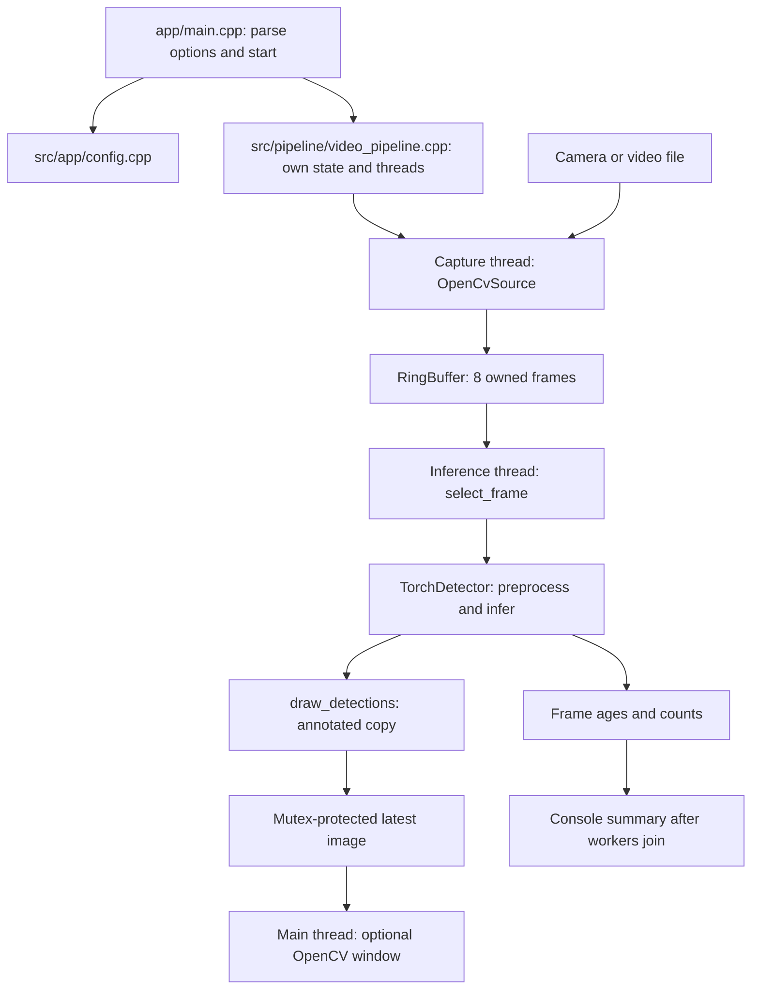

# Low-Latency Object Detection Pipeline

A C++20 program that captures video and runs a pretrained SSDLite object detector.
The goal is to keep detections recent when the camera is faster than inference.
OpenCV handles images; LibTorch runs the exported PyTorch model on the CPU.
This project does not train a new detector.

## How it works

A capture thread puts owned frames into a bounded SPSC (single producer, single
consumer) ring buffer. An inference thread selects frames in one of two ways:

- **FIFO:** process the oldest queued frame.
- **Latest:** consume one snapshot of the queue and keep only its newest frame.

The buffer holds eight frames. When full, capture rejects the incoming frame;
it never overwrites an occupied slot. Latest mode discards old frames on the
consumer side. Neither mode makes the model itself faster.



## Where to start reading

| File | Responsibility |
| --- | --- |
| [app/main.cpp](app/main.cpp) | Entry point and top-level error handling |
| [src/app/config.cpp](src/app/config.cpp) | Parse and validate command-line options |
| [src/pipeline/video_pipeline.cpp](src/pipeline/video_pipeline.cpp) | Start/join workers, capture loop, inference loop, display loop, final accounting |
| [include/llvp/pipeline/frame_selector.hpp](include/llvp/pipeline/frame_selector.hpp) | Shared FIFO/latest selection for real and synthetic frames |
| [include/llvp/core/ring_buffer.hpp](include/llvp/core/ring_buffer.hpp) | Queue storage, publication, consumption, and lifetime rules |
| [src/capture/opencv_source.cpp](src/capture/opencv_source.cpp) | Open a source and return timestamped, owned images |
| [src/inference/torch_detector.cpp](src/inference/torch_detector.cpp) | Convert images into tensors and run the model |
| [src/display/draw_detections.cpp](src/display/draw_detections.cpp) | Scale boxes back onto a copy of the original image |
| [include/llvp/metrics/summary.hpp](include/llvp/metrics/summary.hpp) | Frame counters and percentile calculation |
| [src/synthetic_pipeline.cpp](src/synthetic_pipeline.cpp) | Exercise scheduling without a camera or model |
| [benchmarks/ring_benchmark.cpp](benchmarks/ring_benchmark.cpp) | Measure queue throughput |
| [tests/](tests/) | Automated correctness tests |
| [tools/](tools/) | Model export, model probe, and fixture-video creation |
| [results/](results/) | Saved experiments; not application source code |

Headers in `include/llvp/` declare shared types and interfaces. Matching `.cpp`
files in `src/` implement them. Templates stay in headers because the compiler
needs their definitions when choosing an element type and capacity.

### Ownership and shutdown

Only capture pushes into the queue, and only inference consumes from it.
OpenCV frames are cloned on capture so the backend cannot overwrite published
pixels. A consumer callback moves a frame out before releasing its slot; it
must not throw or retain a reference to that slot. Release/acquire operations
publish initialized objects between threads. Atomic counters collect statistics;
a mutex protects the optional display mailbox and the first worker exception.

The main thread handles window events. The mailbox holds only one annotated
image so display cannot build another backlog. Both workers join before queue
destruction or final accounting. A failed capture or inference requests shutdown
and is reported as `fatal:`. A blocked backend read can delay shutdown: the
requested duration is not a hard timeout on camera I/O.

## Build and test the core (no camera or model needed)

Requirements: C++20 compiler, CMake 3.24+, and Ninja. Run from the repository root.
If the tools are installed in the existing virtual environment, first run:

```sh
export PATH="$PWD/.venv/bin:$PATH"
```

```sh
cmake --preset debug
cmake --build --preset debug
ctest --preset debug --output-on-failure
```

Queue tests cover FIFO, full/empty behavior, wraparound, move-only values,
construction failures, alignment, destruction, and concurrent sequence ordering.
Selector tests cover newest-frame selection and stale-frame counts.
Configuration tests reject missing options, invalid durations, and unknown flags.

Memory/undefined-behavior checks and race checks use separate builds:

```sh
cmake --preset asan-ubsan
cmake --build --preset asan-ubsan
ctest --preset asan-ubsan --output-on-failure

cmake --preset tsan
cmake --build --preset tsan
ctest --preset tsan --output-on-failure
```

ThreadSanitizer support depends on your compiler and operating system.

## Build the detector

The checked-in `vision` preset targets the existing macOS/Python 3.14 environment.
For a fresh setup, create `.venv`, install [requirements-export.txt](requirements-export.txt)
and CMake/Ninja, then export the model:

```sh
python3 -m venv .venv
.venv/bin/python -m pip install -r requirements-export.txt cmake ninja
.venv/bin/python tools/export_model.py
export PATH="$PWD/.venv/bin:$PATH"
cmake --preset opencv
cmake --build --preset opencv -j 6
cmake --preset vision
cmake --build --preset vision -j 6
ctest --preset vision --output-on-failure
```

If your Python version differs, update the Torch prefix in
[CMakePresets.json](CMakePresets.json) and the torchvision operations-library
path in [CMakeLists.txt](CMakeLists.txt) and commands below. The vision preset
reuses the OpenCV source downloaded by the `opencv` preset. Downloads require
network access. Export certificate errors may require setting `SSL_CERT_FILE`
to your environment's CA certificate bundle.

The vision tests add video-file capture and Python/C++ model parity checks.
TorchScript is deprecated upstream; this project keeps its existing exported
contract and checks that LibTorch can load it. The operations library loader
currently uses POSIX `dlopen`, so Windows needs a loader adaptation.

### Model contract

The exporter uses torchvision's pretrained `ssdlite320_mobilenet_v3_large` COCO
weights. Input is contiguous RGB float32, shape `3 x 320 x 320`, range `[0, 1]`.
Output is `N x 6`: `x1, y1, x2, y2, score, class_id`. Boxes use 320-by-320 input
coordinates; filtering and NMS happen inside the exported model. The display
currently draws boxes, not class names. The manifest records versions, checksums,
and parity values. Generated model/tensor binaries are ignored by Git. The dog
fixture comes from the PyTorch Hub examples; torchvision uses BSD-3-Clause.

## Run a visible demo

```sh
build/vision/bin/low_latency_detector \
  --source camera:1 \
  --model models/ssdlite320.pt \
  --ops .venv/lib/python3.14/site-packages/torchvision/_C_stable.so \
  --latest --display --duration-seconds 30
```

Use `camera:0` for another camera, or a video filename for `--source`. Camera
indices can change; `camera:1` was the iPhone in the recorded experiment.
Press `q` or Escape to stop. Omit `--display` for headless measurement; replace
`--latest` with `--fifo` to compare scheduling. Without a duration, capture runs
until the file ends, a capture error occurs, or the display is closed by a key.

For iPhone Continuity Camera, make the phone available to macOS and close other
apps using it. If capture fails, reconnect the phone, check camera permission,
and retry the index. This OpenCV build disables FFmpeg: network URLs are not a
verified input path. Model/ops load errors usually indicate a wrong path or
incompatible dependency versions.

## Compare performance

```sh
./run_phone_comparison.sh camera:1 30 5
./run_bench.sh 10000000
```

The first command runs five 30-second trials per mode in alternating order and
saves raw summaries. The second measures queue transfers/second and amortized
wall time per item, which is not individual handoff latency.

Keep the camera scene, resolution, model, hardware, and display setting fixed.
The current runner includes source/model startup and does not explicitly warm
up inference. Treat these as exploratory live runs, not controlled accuracy or
hardware comparisons. For stronger claims, add a warm-up phase and fixed input.

[Saved phone runs](results/phone_comparison_30s_5reps.txt) gave:

| Average across five runs | FIFO | Latest |
| --- | ---: | ---: |
| Per-run p95 age | 301.8 ms | 65.1 ms |
| Processing rate | 28.37 FPS | 28.13 FPS |

That is a 78.44% reduction in the **average of per-run p95 values**, not a pooled
p95. These historical results are preserved; they are not fresh measurements of
this refactor. Age starts when OpenCV returns a frame and ends after processing
(in display mode, annotation is included). It excludes phone/network/backend
buffering and screen presentation. Throughput includes startup and shutdown.

Each successful run checks:

```text
captured = admitted + overflow_dropped
admitted = processed + stale_dropped + shutdown_dropped
```

If a test fails, start with its named module in the table above. If accounting
fails, inspect queue admission and frame selection before changing the model.
